# iFAS – Intelligent Facial Attendance System

## Project Overview

iFAS (Intelligent Facial Attendance System) is a web-based attendance management system that utilizes facial recognition technology to automate visitor identification and attendance recording.

Originally known as iPALS (Intelligent Patron Attendance Library System), the system was developed collaboratively with my internship team at Universiti Teknologi MARA (UiTM) Shah Alam for Perpustakaan Tun Abdul Razak (PTAR).

I was primarily responsible for planning the overall system workflow, developing backend functionality, implementing Python-based facial recognition, and integrating different system components. My teammates mainly contributed to the user interface development.

After my teammates completed their internships, I continued developing, testing, and improving the system independently.

The system was intended for official library use but has not yet been officially deployed. It has since been renamed to iFAS for personal portfolio and demonstration purposes.

## Live Demo

**Website:** [Visit iFAS](https://ifas.site.je)

> This website is hosted on InfinityFree for portfolio purposes. The live demo may become temporarily or permanently unavailable due to hosting limitations or changes.

> Python-based facial recognition functionality may be limited in the hosted version due to shared hosting restrictions.

### How to Access the Login Page

The homepage is primarily designed for attendance recording. The login page can be accessed directly through the iFAS logo.

1. Visit the iFAS homepage.
2. Hover your mouse cursor over the iFAS logo.
3. Click on the logo to be redirected directly to the login page.
4. Log in using the User or Administrator demo credentials provided above.

This design keeps the main attendance interface clean without displaying a separate login button.

## Demo Accounts

| Role | Login ID | Password |
| --- | --- | --- |
| User | 233333 | hai1234 |
| Administrator | 2000 | hai1234 |

Please use dummy information when testing the system. Do not upload sensitive personal or biometric information.

### Administrator Access Restrictions

The Unidentified Visitor Management page within the Administrator interface is unavailable in the public demo due to privacy and data protection concerns.

This page contains facial images of individuals who have not provided consent for public viewing. Therefore, access to this feature has been restricted to protect their privacy.

This restriction applies only to the public demonstration and does not affect the functionality of the original system.

## My Contributions

**Role: Primary Developer & System Planner**

- Planned the overall system workflow and functionality.
- Designed application logic and module interactions.
- Developed and integrated Python-based facial recognition.
- Implemented backend functionality using PHP.
- Managed database integration and attendance recording.
- Integrated frontend interfaces with backend functionality.
- Conducted system testing, debugging, and troubleshooting.
- Continued development independently after my teammates completed their internships.

## Key Features

### Attendance System

- Real-time facial recognition
- Webcam-based face detection
- Automatic attendance recording
- Manual check-in alternative
- Location-based attendance tracking
- Unrecognized visitor recording

### User Module

- User registration and authentication
- Facial enrollment
- Student and staff identification
- User profile management

### Administrator Module

- Administrator dashboard
- Student and staff management
- Administrator account management
- Attendance record management
- Unrecognized visitor management
- Campus, faculty, and location management

### Reporting and Analytics

- Attendance statistics and visualization
- Monthly and annual attendance reports
- Gender and faculty distribution
- Hourly attendance analysis

## Technology Stack

| Technology | Purpose |
| --- | --- |
| PHP | Backend development and application logic |
| Python | Facial recognition and facial encoding |
| MySQL | Relational database management |
| PDO | Database connectivity |
| JavaScript | Webcam integration and client-side functionality |
| HTML5 & CSS3 | Website interface |
| face-api.js | Browser-based face detection |
| face_recognition | Facial encoding and matching |
| dlib | Facial recognition processing |
| NumPy | Numerical data processing |
| XAMPP | Local development environment |

## System Workflow

1. User selects an attendance location.
2. The system activates the webcam.
3. Face detection is performed using face-api.js.
4. Python processes and compares the captured facial data.
5. The system identifies the registered user.
6. Attendance information is recorded in the database.
7. Administrators can monitor attendance records and generate reports.

Manual check-in is available as an alternative method.

## Technical Skills Demonstrated

- Full-stack web development
- System planning and workflow design
- PHP and Python integration
- Computer vision and facial recognition
- Relational database management
- CRUD operations
- User authentication and session management
- Data visualization and reporting
- System integration and deployment
- Testing and troubleshooting
- Team collaboration and independent development

## System Screenshots

### Homepage

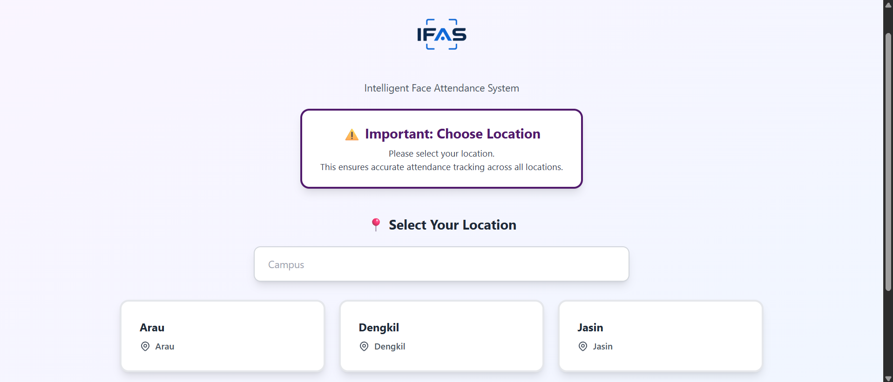

### Facial Recognition

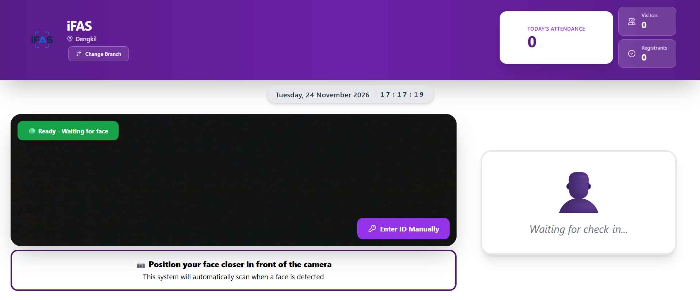

### Manual Check-In

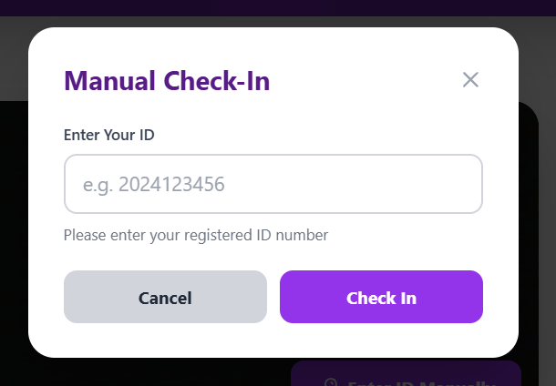

### Login

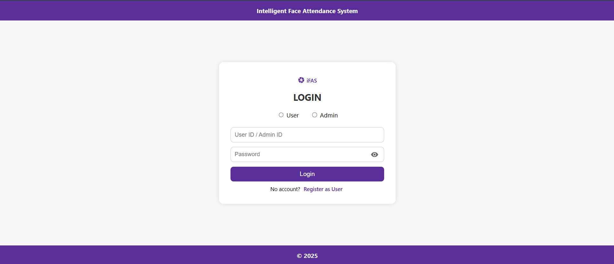

### User Registration

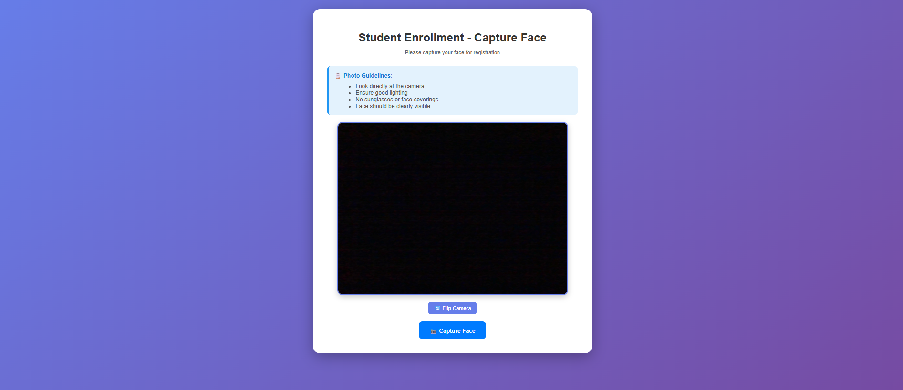

### User Profile

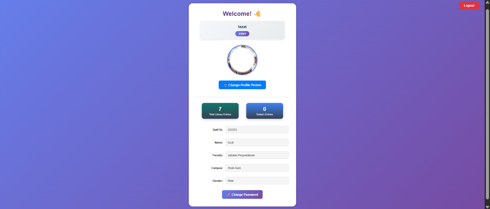

### Administrator Dashboard

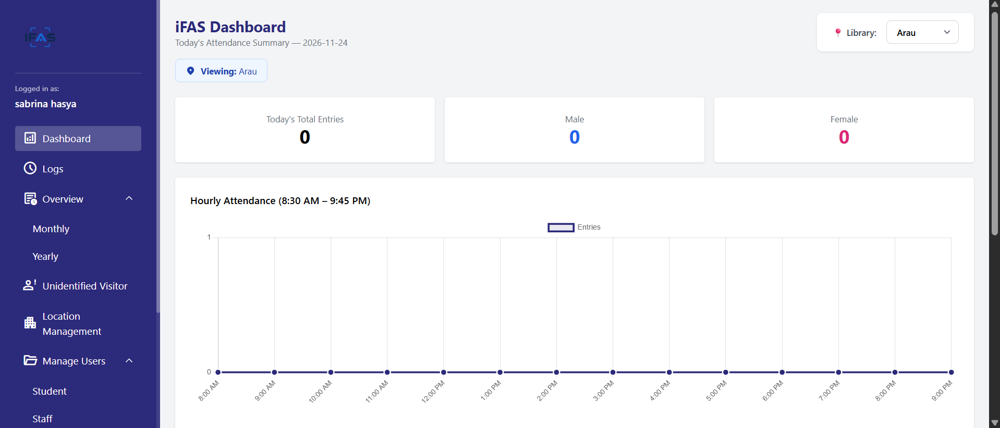

### Attendance Logs

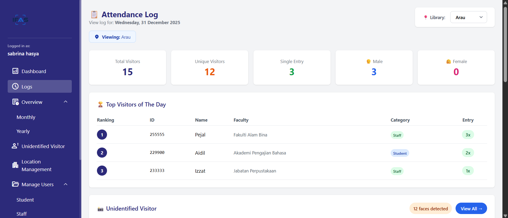

### Monthly Attendance Report

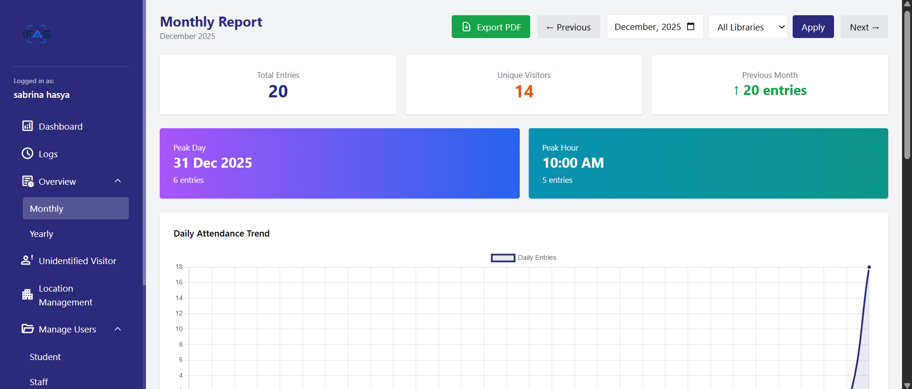

### Annual Attendance Report

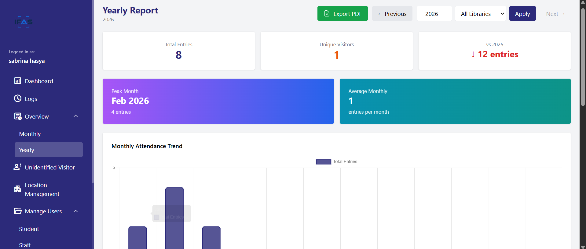

### Location Management

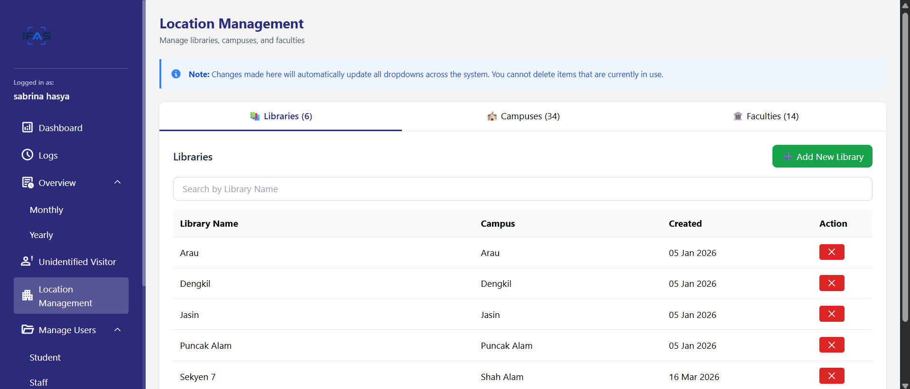

### About

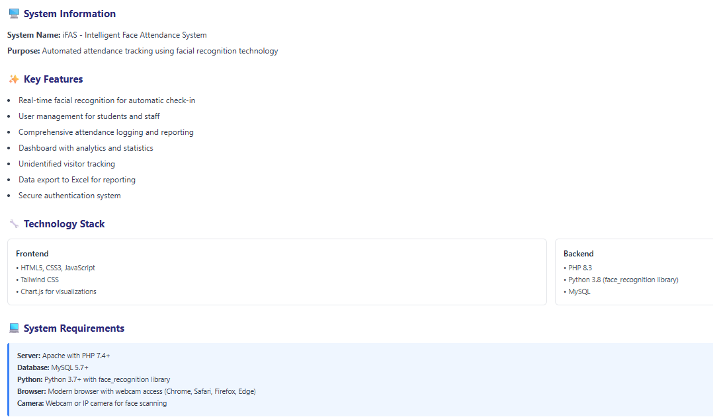

## Demo Video

[Watch System Demonstration](https://youtu.be/gknq8G4F8DY)

## Local Installation

Local installation and setup instructions are not publicly available due to copyright and intellectual property considerations.

As this system was originally developed collaboratively for the UiTM university library and may be officially implemented in the future, unauthorized installation, reproduction, modification, and deployment are not permitted.

This repository is intended solely for portfolio and demonstration purposes. Visitors may explore the system through the provided live demo, screenshots, and demonstration video.

## Known Limitations

- Python-based facial recognition may not be fully supported on InfinityFree.
- Recognition performance depends on lighting, camera quality, and facial positioning.
- Additional security and biometric data protection measures are required before production deployment.

## Future Improvements

- Cloud-based facial recognition API
- Facial liveness detection and anti-spoofing
- Improved recognition accuracy and processing speed
- Enhanced biometric data protection
- Improved system scalability
- Automated database backups

## Project Information

| Information | Details |
| --- | --- |
| Project Name | iFAS |
| Full Name | Intelligent Facial Attendance System |
| Project Type | Industrial Training Project |
| Year | 2025 |
| Development Method | Collaborative Team Development |
| My Role | Primary Developer & System Planner |

## Acknowledgements

Special thanks to my internship teammates for their contributions, particularly in user interface development, and to my supervisors at UiTM Shah Alam for their guidance and support throughout the project.

## Disclaimer

iFAS is a renamed portfolio demonstration adapted from a collaborative industrial training project. It does not represent an officially deployed UiTM service.

Only fictional or appropriately authorized demonstration data should be used. Confidential institutional information and actual user biometric data must not be included in the public repository.

Thank you for taking the time to explore this project!

